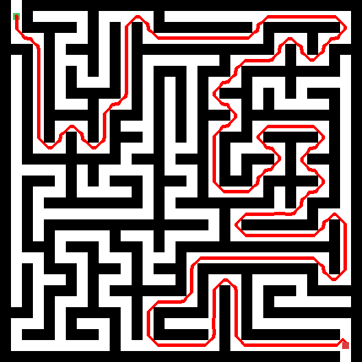
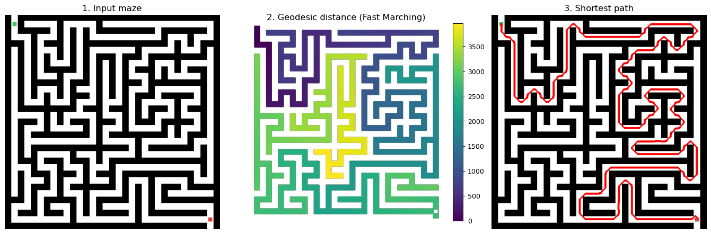

# Geodesic Maze Solver


Solve a **photo or drawing of a maze** with classic image processing — no graph
is ever built by hand. The solver reads the pixels, treats the corridors as free
space and the walls as obstacles, and finds the shortest route with the **Fast
Marching Method** (geodesic distance), inspired by
[Cris Luengo's maze method](https://www.crisluengo.net/archives/277/).

<p align="center">
  
</p>

## How it works

The whole thing is a short image-processing pipeline:



1. **Binarize** — Otsu thresholding splits the image into bright corridors and
   dark walls.
2. **Crop** — cut to the bounding box of the walls, removing the outside margin
   so the path cannot cheat by going *around* the maze.
3. **Seal (guarded)** — morphological *closing* fixes hairline gaps in the walls,
   and a thin frame closes any free strip around the maze. Each seal is kept
   **only if the maze stays connected** (the main corridor network keeps ≥ 94 %
   of its pixels), so a seal never accidentally cuts a real corridor.
4. **Locate endpoints** — the green marker is the start, the red marker is the
   end; each is snapped to the nearest pixel of the main corridor network.
5. **Geodesic distance** — `scikit-fmm` propagates a wave from the start through
   the corridors; the arrival time at each pixel is its distance *inside* the
   maze (it flows around walls, not through them).
6. **Trace & centre** — steepest descent from the end back to the start (only
   orthogonal moves, so it never cuts a wall corner) recovers the shortest path,
   which is then nudged to the middle of the corridors and drawn in red.

Techniques on show: Otsu thresholding, connected-component labelling,
morphological closing/dilation, the Euclidean distance transform, and the Fast
Marching Method for geodesic distance.

## Installation

Requires **Python 3.13** (scikit-fmm has no wheel for 3.14 yet).

```bash
python -m venv .venv
# Windows:  .venv\Scripts\activate
# Linux/macOS:  source .venv/bin/activate
pip install -r requirements.txt
```

## Usage

**Solve any maze image from the terminal:**

```bash
python cli.py examples/maze_medium.png
python cli.py path/to/your_maze.png -o solved.png
python cli.py examples/maze_large.png --steps   # also save the step figures
```

The image needs dark walls on a light background, a **green** (or blue/cyan)
start marker and a **red** end marker.

**Generate fresh example mazes:**

```bash
python src/maze_generator.py       # writes examples/maze_small|medium|large.png
```

**Use it from Python:**

```python
from src.maze_solver import solve_maze_image

result = solve_maze_image("examples/maze_medium.png")
print(result.reached, len(result.path))   # True 3032
# result also carries: maze, distance_map, flood_start/flood_end, solution ...
```

**Read the walkthrough:** [`notebooks/demo.ipynb`](notebooks/demo.ipynb) runs the
pipeline step by step with a figure after every stage.

## Project structure

```
geodesic-maze-solver/
├── cli.py                  # command-line tool
├── src/
│   ├── maze_solver.py      # the pipeline (one function per step)
│   └── maze_generator.py   # synthetic maze-image generator
├── notebooks/demo.ipynb    # step-by-step walkthrough
├── examples/               # generated example mazes
└── assets/                 # README images
```

## References

- Cris Luengo — *Solving mazes using image analysis*:
  <https://www.crisluengo.net/archives/277/>
- **scikit-fmm** (Fast Marching Method): <https://scikit-fmm.readthedocs.io/>
- **scikit-image**: <https://scikit-image.org/>

## Future work

Pip-installable packaging with a console entry point, a unit-test suite, a
GitHub Actions CI that executes the notebook, and a larger gallery of solved
mazes.

## License

[MIT](LICENSE)
