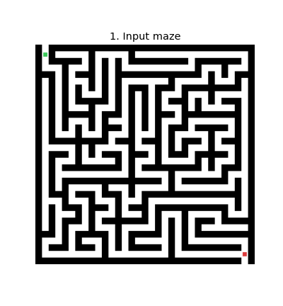
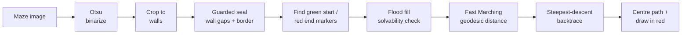

# Geodesic Maze Solver


Solves a **maze image** with classic image processing — no graph is ever built by hand. The
solver reads the pixels, treats corridors as free space and walls as obstacles, and finds the
shortest route with the **Fast Marching Method** (geodesic distance), following
[Cris Luengo's maze method](https://www.crisluengo.net/archives/277/). Packaged as a small
library, a CLI, and a step-by-step notebook.

<p align="center">
  
</p>

## Why this project

A personal learning project in classic image processing.

TODO(eray): one sentence on why you picked this problem, and the month/year it was built.

## How it works




1. **Binarize** — Otsu thresholding splits the image into bright corridors and dark walls.
2. **Crop** — cut to the bounding box of the walls, so the path cannot cheat by going *around*
   the maze.
3. **Seal (guarded)** — morphological *closing* fixes hairline gaps in the walls, and a thin frame
   closes any free strip around the maze. Each seal is kept **only if the main corridor network
   keeps ≥ 94 % of its pixels**, so a seal never cuts a real corridor.
4. **Locate endpoints** — the green (or blue/cyan) marker is the start, the red marker is the end;
   each is snapped to the nearest pixel of the main corridor network.
5. **Check solvability** — 4-connected flood fills from both ends; an unreachable end raises a
   clear error instead of drawing a wrong path.
6. **Geodesic distance** — `scikit-fmm` propagates a wave from the start through the corridors;
   the arrival time at each pixel is its distance *inside* the maze.
7. **Trace & centre** — steepest descent from the end back to the start (orthogonal moves only,
   so it never cuts a wall corner), then the path is nudged to the corridor centre lines using the
   Euclidean distance transform and drawn in red.

Techniques on show: Otsu thresholding, connected-component labelling, morphological
closing/dilation, flood fill, the Euclidean distance transform, and the Fast Marching Method.

## Results

All three bundled example mazes are solved end to end:

| Example | Grid | Image size | Path found | Path length |
|---|---|---|---|---|
| `maze_small.png` | 10×10 | 336×336 | ✅ | 1032 px |
| `maze_medium.png` | 16×16 | 528×528 | ✅ | 3032 px |
| `maze_large.png` | 24×24 | 784×784 | ✅ | 5398 px |

The example generator (`src/maze_generator.py`) re-solves every maze it writes and `assert`s that
the path reaches the start, so regenerating the examples doubles as an end-to-end check.

TODO(eray): if you remember mazes from your own tests (the ready-made images) that the solver
could not handle, describe them under Limitations.

## Installation

Tested with **Python 3.12 and 3.13** (scikit-fmm has no wheel for 3.14 yet).

```bash
python -m venv .venv
# Windows:  .venv\Scripts\activate
# Linux/macOS:  source .venv/bin/activate
pip install -r requirements.txt
```

## Usage

**Solve any maze image from the terminal:**

```bash
python cli.py examples/maze_medium.png
python cli.py path/to/your_maze.png -o solved.png
python cli.py examples/maze_large.png --steps   # also save the step figures
```

The image needs dark walls on a light background, a **green** (or blue/cyan) start marker and a
**red** end marker. The CLI exits with code 1 if the path does not reach the start.

**Generate fresh example mazes:**

```bash
python src/maze_generator.py       # writes examples/maze_small|medium|large.png
```

**Use it from Python:**

```python
from src.maze_solver import solve_maze_image

result = solve_maze_image("examples/maze_medium.png")
print(result.reached, len(result.path))   # True 3032
# result also carries: maze, distance_map, flood_start/flood_end, solution ...
```

**Read the walkthrough:** [`notebooks/demo.ipynb`](notebooks/demo.ipynb) runs the pipeline step
by step with a figure after every stage (needs `pip install notebook` in addition to
`requirements.txt`).

## Project structure

```
geodesic-maze-solver/
├── cli.py                  # command-line tool
├── src/
│   ├── maze_solver.py      # the pipeline (one function per step)
│   └── maze_generator.py   # synthetic maze-image generator
├── notebooks/demo.ipynb    # step-by-step walkthrough
├── examples/               # generated example mazes
└── assets/                 # README images
```

## Limitations

- **Marker convention required.** The start and end are found by colour; an image without a
  green/blue/cyan and a red marker raises an error.
- **Not tested on photographs.** Tested on generated and ready-made maze images only. The
  binarization is a single global Otsu threshold, which assumes evenly lit, high-contrast input.
- **Orthogonal moves.** The backtrace moves in four directions, so diagonal corridors produce a
  staircase path.

## Future work

Pip-installable packaging with a console entry point, a unit-test suite, a GitHub Actions CI that
executes the notebook, and a larger gallery of solved mazes.

## About

Solo, self-directed learning project.

## References

- Cris Luengo — *Solving mazes using image analysis*:
  <https://www.crisluengo.net/archives/277/>
- **scikit-fmm** (Fast Marching Method): <https://scikit-fmm.readthedocs.io/>
- **scikit-image**: <https://scikit-image.org/>

## License

[MIT](LICENSE)
